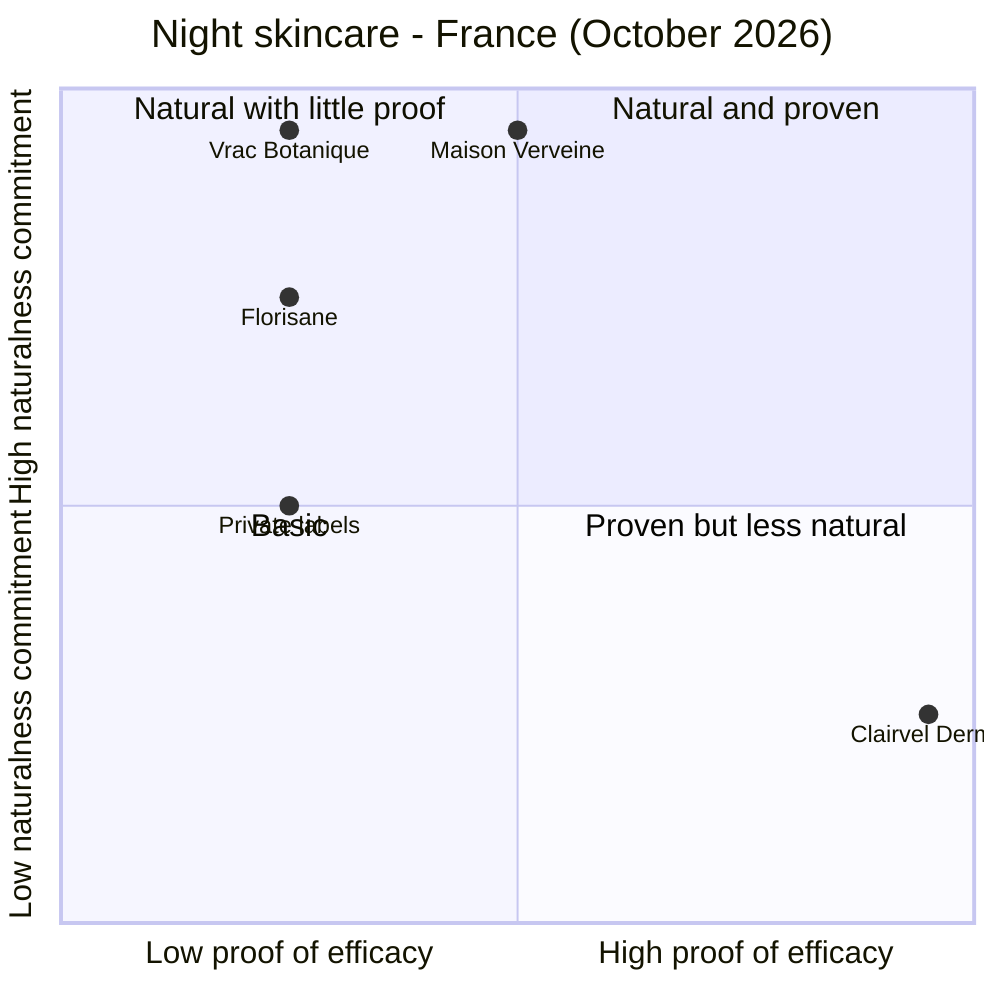

# Example - Competitive analysis for Maison Verveine

> Fictional brand, competitors and data. Florisane, Clairvel Dermo and Vrac Botanique are
> invented names for teaching purposes; "organic-store private labels" is a generic
> category. Scores and prices are illustrative and consistent with the pack's fictional
> case (`examples/maison-verveine.md`). Deliverable shown as the skill would save it in
> `marketing-deliverables/competitive-analysis.md`.

---

# Competitive analysis - Maison Verveine - Natural facial skincare, France

_October 2026 · Decision at stake: reposition the skincare range after the summer's quality
and service issues, and decide on refills · Personas: P1 The Committed Naturalist, P2 The
Results-Driven Skin Fixer (P3 for gifts, secondary)._

## 1. Summary

- **Market reading**: natural brands compete on composition and eco-design but offer little
  proof of efficacy; pharmacy brands own proof and tolerance but not naturalness. The space
  "natural **and** proven" is almost empty.
- **Positioning**: Maison Verveine should own "natural skincare that proves its results",
  which matches P1 (values) and P2 (results), provided it fixes tolerance and service first.
- **Top 3 actions**: publish efficacy and tolerance tests for the hero products; launch a
  refill pilot to catch up with Florisane and Vrac Botanique; restore delivery reliability
  before any acquisition campaign.

## 2. Competitive set

| Competitor | Circle | Why it competes | Main source |
|---|---|---|---|
| Florisane | Direct | Natural skincare sold online, same target P1, cheaper | Website, 120 public reviews (Jun-Sep 2026) |
| Clairvel Dermo | Indirect | Pharmacy dermo-cosmetics; P2 compares "natural vs pharmacy" | Pharmacy websites, product leaflets |
| Vrac Botanique | Substitute | Solid, zero-waste skincare and refill stations; attracts P1 | Website, store visit (Sep 2026) |
| Organic-store private labels | Indirect | Cheaper natural basics in the stores where Maison Verveine is also sold | Store visits in 3 partner stores |

Evidence of comparison by customers: S4 interviews (3/6 mention a pharmacy brand, 2/6 a
cheaper natural brand); S1 reviews on price and formats (15 mentions) show that customers
compare value.

## 3. Key purchase criteria

| Criterion | Why it matters | Weight P1 | Weight P2 |
|---|---|---|---|
| Proof of efficacy | P2 chooses on results (S1: 37 efficacy mentions) | 2 | 5 |
| Tolerance / sensitive skin | Skin reactions are a dealbreaker (S1 weak signal) | 3 | 5 |
| Naturalness and transparency | Core of P1's choice (S1: 35 mentions) | 5 | 2 |
| Eco-friendly packaging, refills | P1 expectation (S1: 6 refill requests, 21 broken jars) | 4 | 1 |
| Sensory experience | Texture and scent praised (S1: 26) | 3 | 3 |
| Delivery and service reliability | Main pain point since July (S1: 33 + 36) | 4 | 4 |
| Price / value | Formats seen as small (S1: 15) | 3 | 2 |
| Availability | Buying where and when needed | 2 | 3 |

## 4. Offer and price benchmark (night cream, checked 10 October 2026)

| Player | Product | Size | Price | Per 100 ml | Free shipping from | Returns | Loyalty |
|---|---|---|---|---|---|---|---|
| Maison Verveine | Crème Nuit Réparatrice | 50 ml | €34 | €68 | €59 | 30 days | none |
| Florisane | Crème de nuit | 50 ml | €24 | €48 | €39 | 14 days | points; refill €19 |
| Clairvel Dermo | Soin nuit peaux sensibles | 40 ml | €19 | €47.50 | pharmacy (no shipping) | in store | pharmacy card |
| Vrac Botanique | Baume de nuit solide | 40 g | €18 | €45 (per 100 g) | €45 | 14 days | refill discount |
| Private labels | Crème de nuit bio | 50 ml | €12 | €24 | in store | in store | store card |

## 5. Comparison grid (1-5)

| Criterion | Maison Verveine | Florisane | Clairvel Dermo | Vrac Botanique | Private labels |
|---|---|---|---|---|---|
| Proof of efficacy | 3 - user reviews only, no test published - High | 2 - generic claims - Medium | 5 - clinical tests on leaflet - High | 2 - none - Medium | 2 - none - Medium |
| Tolerance | 2 - reformulation reactions, unsupported claim (S1, audit) - High | 3 - few complaints - Low | 5 - tested under dermatological control - High | 3 - Low | 3 - Low |
| Naturalness and transparency | 5 - short INCI, origin - High | 4 - Medium | 2 - long INCI - High | 5 - High | 3 - Medium |
| Eco packaging, refills | 3 - glass but breakage, no refill - High | 4 - refills - High | 2 - plastic - High | 5 - solid, refill stations - High | 2 - plastic - Medium |
| Sensory | 5 - S1 26 mentions - High | 3 - Low | 3 - Medium | 2 - texture criticised in reviews - Medium | 3 - Low |
| Delivery and service | 2 - since July (S1, S5) - High | 4 - "48h" praised in reviews - Medium | 4 - pharmacy availability - Medium | 3 - Low | 4 - in store - Medium |
| Price / value | 3 - Medium | 4 - Medium | 4 - High | 4 - Medium | 5 - High |
| Availability | 3 - online + 40 stores - High | 3 - online - High | 5 - pharmacies everywhere - High | 2 - 6 stores + online - High | 4 - organic stores - High |

## 6. What customers say (public reviews, Jun-Sep 2026, fictional sample)

| Player | Praised for | Criticised for |
|---|---|---|
| Maison Verveine | Results, texture, scent, transparency, samples | Delivery, unreachable service, broken jars, new formula |
| Florisane | Price, refills, fast delivery | "Doesn't do much", frequent promotions blur the price |
| Clairvel Dermo | Tolerance, "recommended by my pharmacist" | Clinical feel, long ingredient list |
| Vrac Botanique | Zero waste, values | Texture hard to apply, small range |
| Private labels | Price | No advice, basic results |

## 7. Communication

| Player | Promise | Proof | Tone |
|---|---|---|---|
| Maison Verveine | Short formulas, French plants, visible results | Origin, INCI; results claimed but not demonstrated | Warm, artisanal |
| Florisane | Natural beauty for everyone | Price, refills | Friendly, promotional |
| Clairvel Dermo | Expert care for sensitive skin | Clinical tests, dermatologists | Medical, reassuring |
| Vrac Botanique | Beauty without waste | Zero packaging | Activist |

## 8. Positioning map

Positions computed from the grid: x = "proof of efficacy" score, y = "naturalness and
transparency" score, both rescaled as (score - 1) / 4; values of 1.0 are drawn at 0.95 for
readability. Maison Verveine is the closest
natural brand to the empty "natural and proven" quadrant.

## 9. Value curve

| Factor | Maison Verveine | Florisane | Clairvel Dermo | Vrac Botanique |
|---|---|---|---|---|
| Proof of efficacy | 3 | 2 | 5 | 2 |
| Tolerance | 2 | 3 | 5 | 3 |
| Naturalness | 5 | 4 | 2 | 5 |
| Eco packaging | 3 | 4 | 2 | 5 |
| Sensory | 5 | 3 | 3 | 2 |
| Delivery and service | 2 | 4 | 4 | 3 |
| Price / value | 3 | 4 | 4 | 4 |

| Eliminate | Reduce | Raise | Create |
|---|---|---|---|
| Unsupported claims ("hypoallergenic"); codes with hidden exclusions | Generic discounting | Proof of efficacy and tolerance; delivery reliability; service access | A public "formula log" (every change explained); a refill programme for hero products |

## 10. Positioning and actions

**Positioning statement**: For people who want visible results without compromising on
what they put on their skin (P1, P2), Maison Verveine is the natural skincare brand from
the Drôme whose short formulas are **proven on skin**, because every hero product is tested
for efficacy and tolerance and every formula change is published. Unlike pharmacy brands,
it stays natural and sensorial; unlike other natural brands, it proves what it promises.

| Action | Rationale | Owner | Horizon | KPI |
|---|---|---|---|---|
| Efficacy and tolerance tests on the Crème Nuit and the Sérum; publish protocol and results | Raise proof; answer P2; secure claims | Quality / R&D | 6 months | Tests published; conversion of the two pages |
| Public formula log and reformulation policy | Create trust; turn a weakness into a difference | Product + Communication | 1 month | Mentions of "transparency" in reviews |
| Restore delivery reliability before acquisition spend | Delivery is where Florisane and pharmacies win | Logistics | 3 months | Share delivered in 3 working days or less |
| Refill pilot on the Crème Nuit | Catch up on eco criterion vs Florisane and Vrac Botanique | Product | 6 months | Pre-orders; P1 repeat rate |
| Rewrite messages around "natural and proven" (site, CRM, packaging) | Make the positioning visible | Marketing | 3 months | Brand perception survey |

## 11. Monitoring

| What | Source | Frequency | Owner |
|---|---|---|---|
| Competitor prices and offers | Websites, price alerts | Monthly | E-commerce |
| Competitor reviews (themes) | Public reviews exported, analysed with voc-skill | Quarterly | Marketing |
| New claims or tests published by competitors | Websites, pharmacy leaflets | Quarterly | Quality |
| Our position on the map | Customer survey (2 axes) | Yearly | Marketing |
