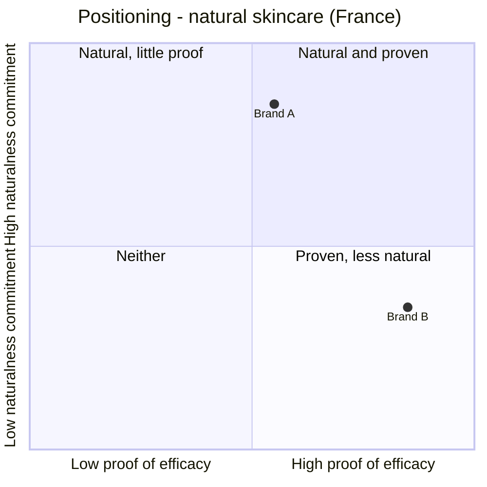

# Competitive analysis method

## Identifying competitors

Bergen and Peteraf (2002) propose identifying competitors along two dimensions: **market
commonality** (do we serve the same customer needs?) and **resource similarity** (do we
have similar capabilities and assets?). Firms high on both are direct competitors; firms
serving the same needs with different resources are indirect competitors or substitutes,
often the ones that disrupt a market.

| Circle | Definition | Example (natural skincare D2C) |
|---|---|---|
| Direct | Same need, same type of offer and channel | Other natural cosmetics brands sold online |
| Indirect | Same need, different solution or channel | Pharmacy dermo-cosmetics, organic-store private labels |
| Substitutes | Another way to do the job | DIY cosmetics, zero-waste solid products, doing nothing |

Ask customers who they compared you with: reviews ("I used to buy X"), sales and support
feedback, search queries "brand vs".

## Industry view (optional)

For a market-entry or strategic decision, add a short five forces reading: rivalry,
threat of new entrants, threat of substitutes, bargaining power of buyers and of suppliers
(Porter, 2008). Keep it to the forces that change the decision.

## Scoring with evidence

| Score | Meaning |
|---|---|
| 5 | Clear market reference on this criterion, praised by customers |
| 4 | Strong, few criticisms |
| 3 | At market level |
| 2 | Below market, criticised |
| 1 | Major weakness |

Each score: source (URL or document), date, confidence (High / Medium / Low).

## Positioning map (Mermaid)

Rules: coordinates between 0 and 1; axes must matter to customers and discriminate between
players; explain how each position was estimated.

## Value curve and "eliminate, reduce, raise, create"

Kim and Mauborgne (2005) represent each player's offer as a curve across the competing
factors (strategy canvas). A distinctive strategy has a curve that differs from the
competitors'. To redraw the curve, ask:
- **Eliminate**: which factors that the industry takes for granted can be removed?
- **Reduce**: which factors can be reduced well below the industry standard?
- **Raise**: which factors should be raised well above the standard?
- **Create**: which factors that the industry has never offered should be created?

## Positioning statement

> For [target persona] who [need or problem], [brand] is the [frame of reference] that
> [main benefit / point of difference], because [reasons to believe / proof]. Unlike
> [main alternative], [brand] [key difference].

Check: is it relevant to the target, different from competitors, credible (provable),
sustainable (hard to copy)?

## References

- Bergen, M., & Peteraf, M. A. (2002). Competitor identification and competitor analysis:
  a broad-based managerial approach. *Managerial and Decision Economics*, 23(4-5), 157-169.
  https://doi.org/10.1002/mde.1059
- Kim, W. C., & Mauborgne, R. (2005). *Blue Ocean Strategy*. Harvard Business School Press.
- Porter, M. E. (2008). The five competitive forces that shape strategy. *Harvard Business
  Review*, 86(1), 78-93.
