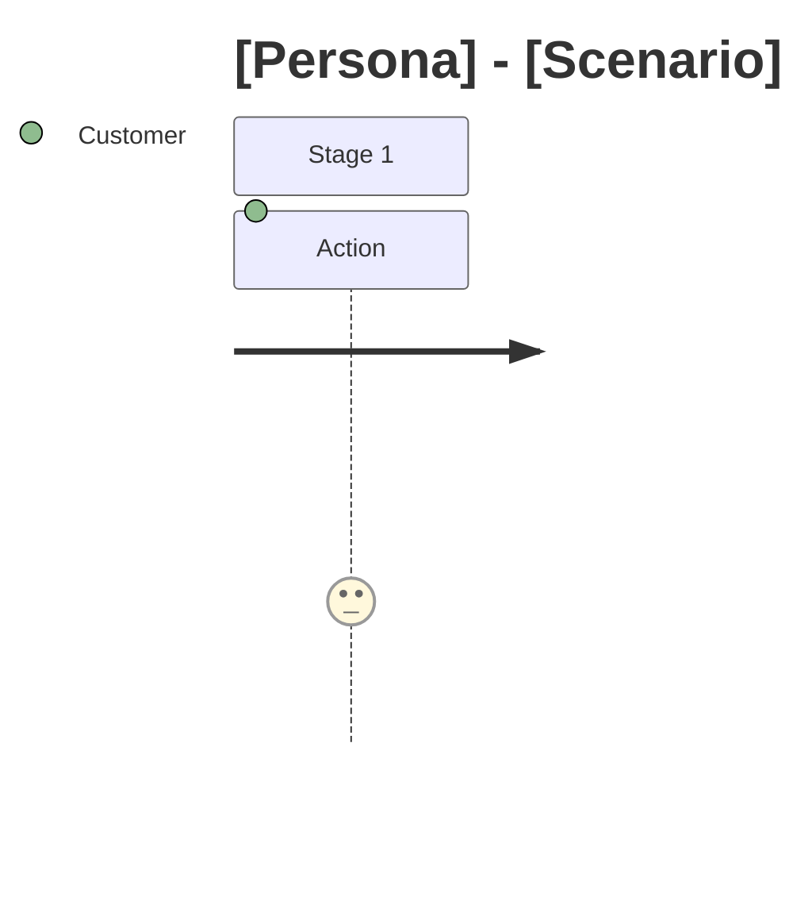

# Customer journey - [Persona ID and name] - [Scenario]

_Date · Persona source: `01-personas.md` · Start: [...] · End: [...] · Channels in scope: [...]_

## 1. Summary

- Scenario in one sentence:
- Moments of truth:
- Top 3 opportunities:

## 2. Sources

| ID | Source | Type | Confidence contribution |
|---|---|---|---|
| S1 | | | |

## 3. Journey map

| | Stage 1 | Stage 2 | Stage 3 | ... |
|---|---|---|---|---|
| **Phase** | pre-purchase | purchase | post-purchase | |
| **Customer goal** | | | | |
| **Actions** | | | | |
| **Touchpoints** (type) | | | | |
| **Thoughts / quotes** | | | | |
| **Emotion (1-5)** | | | | |
| **Pain points** | | | | |
| **Moment of truth?** | | | | |
| **Backstage** (teams, systems, partners) | | | | |
| **Evidence / confidence** | | | | |

## 4. Emotion curve

| Stage | Emotion | Why |
|---|---|---|
| | | |

## 5. Opportunities

| ID | Opportunity | Answers | Type | Customer (1-3) | Business (1-3) | Effort (1-3, 3 = easy) | Priority | Owner | Indicator | Horizon |
|---|---|---|---|---|---|---|---|---|---|---|
| O1 | | pain point / stage | CRM / Service / Product / Logistics / Digital / Pricing | | | | | | | |

## 6. Hypotheses to validate

| Hypothesis | Stage | Method |
|---|---|---|

## 7. Next step

CRM plan (skill `plan-crm`) from the opportunities tagged *CRM*.
