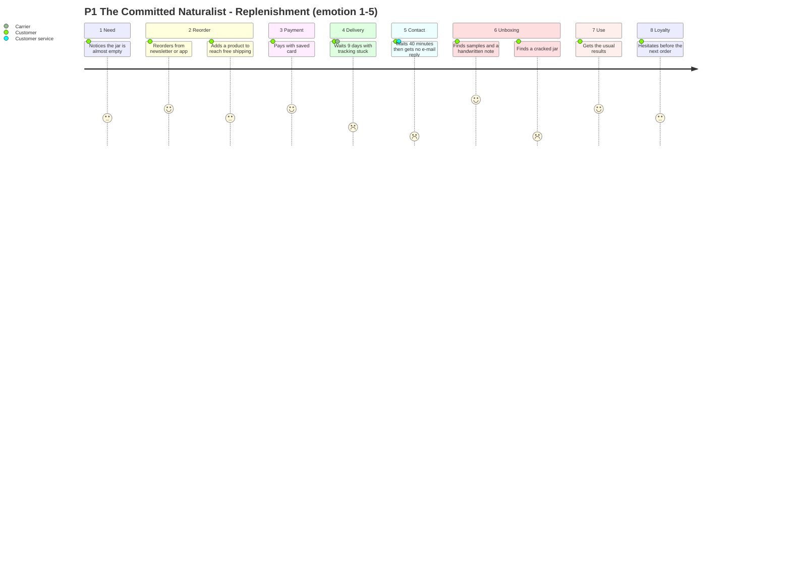

# Example - Replenishment journey of P1 for Maison Verveine

> Fictional brand and data (see the pack's `examples/maison-verveine.md`). This journey
> builds on the persona example (`persona/references/example-maison-verveine.md`) and on the
> Voice-of-the-Customer report produced with voc-skill. French quotes are verbatims from the
> fictional dataset, quoted with their ID. Deliverable shown as the skill would save it in
> `marketing-deliverables/02-customer-journey-P1-replenishment.md`.

---

# Customer journey - P1 The Committed Naturalist - Replenishment of the Crème Nuit

_October 2026 · Persona source: `01-personas.md` · Start: she notices her jar is almost
empty · End: next order (or not) · Channels in scope: app, mobile site, newsletter,
carrier, customer service (phone, e-mail, chat). State: current ("as is"), September 2026._

## 1. Summary

- **Scenario**: a loyal customer reorders her night cream, as she does every three months.
  Since July, this routine purchase has become one of the riskiest moments of the
  relationship.
- **Moments of truth**: delivery (stage 4), the "where is my order?" contact (stage 5,
  the negative peak) and unboxing (stage 6).
- **Top 3 opportunities**: proactive delay notification and realistic dates (O1),
  self-service tracking with callback (O2), protective cardboard insert for glass jars (O4).

## 2. Sources

| ID | Source | Type | Used for |
|---|---|---|---|
| P1 | Persona card "The Committed Naturalist" (`01-personas.md`) | synthesis | goals, channels, criteria |
| S1 | Voice-of-the-Customer report, Apr-Sep 2026, 205 verbatims | qualitative, coded | pain points, emotions, quotes |
| S2 | CRM extract | quantitative | reorder cycle, basket |
| S3 | Web analytics | quantitative | channels, funnel |
| S5 | Customer service ticket tags, Jul-Sep 2026 (3,950 tickets) | quantitative | contact reasons: "where is my order" 41 %, breakage 7 % |

## 3. Journey map

| | 1. Need | 2. Reorder | 3. Payment | 4. Delivery | 5. Contact | 6. Unboxing | 7. Use | 8. Loyalty |
|---|---|---|---|---|---|---|---|---|
| **Phase** | pre-purchase | purchase | purchase | post-purchase | post-purchase | post-purchase | post-purchase | post-purchase |
| **Customer goal** | Not run out of her routine product | Reorder quickly, without a bad surprise | Pay simply | Receive the parcel within the announced time | Know where the parcel is | Get intact products | Keep the same results | Stay with a brand she trusts |
| **Actions** | Sees the jar is nearly empty | Opens the newsletter or the app, adds the cream, then a soap to pass the €59 threshold | Pays with saved card | Follows the tracking link | Calls, waits, writes an e-mail, tries the chat | Opens the parcel | Applies the cream every night | Considers the next order, leaves (or not) a review |
| **Touchpoints** (type) | Product jar (customer-owned) | Newsletter, app (brand-owned) | Checkout (brand-owned), payment provider (partner-owned) | Carrier tracking, pick-up point (partner-owned) | Phone, e-mail, chat (brand-owned) | Parcel, inserts, samples (brand-owned) | Product, label "new formula" (brand-owned) | Review request (brand-owned), reviews and friends (social/external) |
| **Thoughts / quotes** | _"I'll order before the weekend."_ (illustrative) | _"Shipping is free only above €59 now..."_ (illustrative, S1: 15 price/shipping mentions) | - | « Avant je recevais en 2 jours, maintenant c'est plus d'une semaine. » S1, AV-0111 | « Impossible de joindre le service client, 40 minutes d'attente au téléphone. » S1, AV-0037 | « Petit mot manuscrit et échantillons offerts, j'ai été touchée. » S1, AV-0043 / « Deuxième fois que je reçois un pot fêlé. Le calage est insuffisant. » S1, AV-0091 | _"New formula? Nobody told me."_ (illustrative, S1: AV-0174 and call 4) | « Composition courte et naturelle, ça me rassure. » S1, AV-0035 |
| **Emotion (1-5)** | 3 | 4 | 4 | 2 | 1 | 4 if intact, 1 if broken | 4 | 3 |
| **Pain points** | No reminder from the brand | Free-shipping threshold raised; codes with hidden exclusions | - | Delays since the carrier change (29 of the 31 dated delay reviews are from Jul-Sep); tracking stuck; pick-up point changed | Long waits, unanswered e-mails, repeating the problem (36 verbatims, intensity 4) | Broken glass jars (21 verbatims, intensity 4; 7 % of tickets) | Reformulation not explained | The memory of the experience is dominated by stages 4-5 |
| **Moment of truth?** | | | | **Yes** | **Yes (negative peak)** | **Yes** | | **Yes (end)** |
| **Backstage** | CRM has the reorder cycle but no trigger | E-mail tool; pricing rules | Payment provider | New carrier (since July); no delay alert | 5 advisors; ticketing tool without order history; no callback | Packing: one paper layer around jars | Formula changed in August; no communication plan to existing buyers | Review request sent at day 7, whatever the delivery status |
| **Evidence / confidence** | S2 (reorder every ~95 days) - High | S3, S1 - Medium | S3 (low checkout drop-off) - Medium | S1, S5 - High | S1, S5 - High | S1, S5 - High | S1 (weak signal) - Low | S1, S2 - Medium |

## 4. Emotion curve

| Stage | Emotion | Why |
|---|---|---|
| 1. Need | 3 | Neutral routine moment; no help from the brand |
| 2. Reorder | 4 | Familiar, quick; slight irritation with the €59 threshold |
| 3. Payment | 4 | Smooth (low checkout drop-off in S3) |
| 4. Delivery | 2 | Delays and tracking issues since July (S1, S5) |
| 5. Contact | 1 | Negative peak: effort, waiting, no answer (S1 intensity 4) |
| 6. Unboxing | 4 / 1 | Delight from the attentions; anger when a jar is broken |
| 7. Use | 4 | Product satisfaction stays high (S1: 37 efficacy mentions) |
| 8. Loyalty | 3 | Peak (stage 5) and end both negative for part of the customers: loyalty is at risk |

## 5. Opportunities

| ID | Opportunity | Answers | Type | Customer | Business | Effort (3 = easy) | Priority | Owner | Indicator | Horizon |
|---|---|---|---|---|---|---|---|---|---|---|
| O1 | Realistic delivery dates at checkout + proactive message as soon as a parcel is late, with a gesture for loyal customers | Stages 4-5 | CRM / Digital | 3 | 3 | 2 | 18 | E-commerce + CRM | "Where is my order" contacts: -30 % | 1 month |
| O2 | Self-service tracking page and callback instead of phone waiting; e-mail answer within 48 h | Stage 5 | Service | 3 | 3 | 2 | 18 | Customer service | Answer rate > 90 %; e-mail reply < 48 h | 1-3 months |
| O4 | Moulded-cardboard insert for glass jars, validated by drop tests | Stage 6 | Logistics | 3 | 2 | 3 | 18 | Logistics | Breakage complaints < 0.5 % of orders | 1 month |
| O5 | Replenishment reminder around day 80 after the last order (app push or e-mail), with the usual basket pre-filled | Stage 1 | CRM | 2 | 3 | 3 | 18 | CRM | Reorder rate at 120 days | 1 month |
| O6 | Explain the reformulation to existing buyers (what changed, why, patch test advice) and follow up on reactions | Stage 7 | CRM / Product | 2 | 3 | 3 | 18 | Product + CRM + Quality | Reaction reports; reorder rate of the cream | Immediate |
| O7 | "Good end" message 10 days after delivery: usage tip, how to reach an advisor, review request only if the order went well | Stages 6-8 (end) | CRM | 2 | 2 | 3 | 12 | CRM | Review rating; repeat rate | 1 month |
| O10 | Free shipping from €49 for customers with 3+ orders | Stage 2 | Pricing / CRM | 2 | 2 | 3 | 12 | E-commerce | Basket, order frequency of loyal customers | 3 months |
| O3 | Carrier improvement plan with penalties; second carrier as back-up | Stage 4 | Logistics | 3 | 3 | 1 | 9 | Logistics | Share of parcels delivered in 3 working days or less | 3 months |
| O8 | Loyalty rewards based on early access and samples rather than discounts | Stage 8 | CRM | 2 | 2 | 2 | 8 | CRM | Repeat rate of P1 segment | 6 months |
| O9 | Refill pilot on the Crème Nuit | Stages 6-8 | Product | 2 | 2 | 1 | 4 | Product | Pre-orders | 6 months + |

Opportunities tagged **CRM** (O1, O5, O6, O7, O8, O10) are inputs for the `plan-crm` skill.

## 6. Hypotheses to validate

| Hypothesis | Stage | Method |
|---|---|---|
| A day-80 reminder increases reorders without irritating P1 | 1 | A/B test on the loyal RFM segment |
| P1 customers who had a delivery problem since July reorder less | 8 | CRM cohort analysis: repeat rate with vs without a "where is my order" ticket |
| The reformulation worries P1 as well as P2 | 7 | 5 short calls + question in the next satisfaction survey |

## 7. Next step

Build the CRM plan (skill `plan-crm`) from O1, O5, O6, O7, O8 and O10, for P1 first, then P2
and P3.
