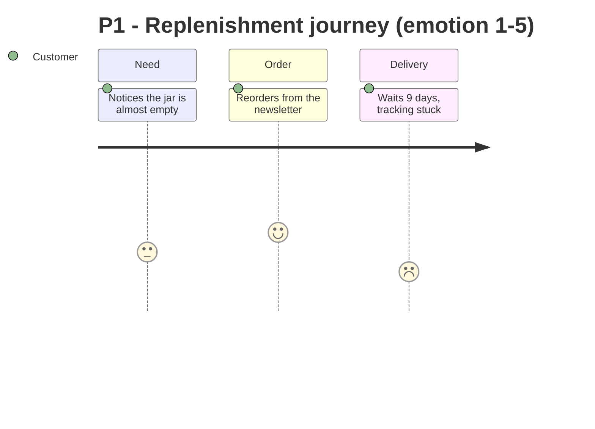

# Customer journey method

## Foundations

- **Customer experience as a journey.** Lemon and Verhoef (2016) define customer
  experience as a multidimensional construct (cognitive, emotional, behavioural, sensorial,
  social) that unfolds over three phases: pre-purchase, purchase and post-purchase. They
  classify touchpoints into four types: **brand-owned** (designed and controlled by the
  brand), **partner-owned** (carriers, marketplaces, retailers), **customer-owned** (the
  customer's own actions and choices) and **social/external** (other customers, reviews,
  media, peers).
- **A research field of its own.** Følstad and Kvale (2018) review the customer journey
  literature and distinguish the journey as *experienced* by the customer from the journey
  as *designed* by the company. A map mixes both: say which is which.
- **Backstage.** Service blueprinting (Bitner, Ostrom & Morgan, 2008) adds what the
  customer does not see: front-office staff, back-office processes, support systems. Use
  it when the pain points come from internal processes (refunds, stock, carriers).
- **Peak-end rule.** People remember an experience mostly by its most intense moment and
  its end (Kahneman, Fredrickson, Schreiber & Redelmeier, 1993). Map emotions carefully at
  these moments.
- **Customer effort.** Reducing the effort customers must make to solve a problem is a
  stronger loyalty lever than exceeding expectations (Dixon, Freeman & Toman, 2010).

## Emotion scale

| Score | Meaning | Typical evidence |
|---|---|---|
| 5 | Delight | enthusiastic reviews, spontaneous recommendation |
| 4 | Satisfaction | positive comments, smooth step |
| 3 | Neutral | step done without comment |
| 2 | Irritation | complaints, extra effort, contact with customer service |
| 1 | Anger / rupture | escalation, refund demand, churn statement |

Base the score on evidence (VoC themes and intensity, ratings, ticket volumes, funnel drop-
offs). Without evidence, mark the score as a hypothesis.

## Stage variants

| Context | Suggested stages |
|---|---|
| E-commerce (default) | Need · Search · Choice and order · Delivery · First use · Regular use · Support and returns · Loyalty |
| Physical retail | Need · Search · Visit · Advice · Purchase at checkout · Use · After-sales · Return visit |
| Services / subscription | Need · Discovery · Subscription · Onboarding · Regular use · Incident · Renewal or cancellation |
| B2B | Problem recognition · Research · Shortlist · Evaluation and demo · Negotiation and contract · Onboarding · Use and support · Renewal and expansion |

## Opportunity scoring

| Criterion | 1 | 2 | 3 |
|---|---|---|---|
| Impact on the customer | minor irritant removed | clear improvement at a stage | changes a moment of truth |
| Business impact | marginal | measurable on one KPI | revenue, retention or risk at stake |
| Effort (inverted) | heavy project | medium project | quick fix |

Priority = customer x business x effort (1 to 27). Above 12: priority; 6-12: plan; below 6:
backlog. Tag each opportunity with its type: *CRM* (message, trigger, segment), *Service*,
*Product*, *Logistics*, *Digital*, *Pricing*. CRM-tagged opportunities feed the `plan-crm`
skill.

## Mermaid emotion curve

````markdown

````

Rules: one `section` per stage, `Task label: score: Actor`, score 1-5, no colon inside the
task label.

## References

- Bitner, M. J., Ostrom, A. L., & Morgan, F. N. (2008). Service blueprinting: a practical
  technique for service innovation. *California Management Review*, 50(3), 66-94.
  https://doi.org/10.2307/41166446
- Dixon, M., Freeman, K., & Toman, N. (2010). Stop trying to delight your customers.
  *Harvard Business Review*, 88(7/8), 116-122.
- Følstad, A., & Kvale, K. (2018). Customer journeys: a systematic literature review.
  *Journal of Service Theory and Practice*, 28(2), 196-227.
  https://doi.org/10.1108/JSTP-11-2014-0261
- Kahneman, D., Fredrickson, B. L., Schreiber, C. A., & Redelmeier, D. A. (1993). When more
  pain is preferred to less: adding a better end. *Psychological Science*, 4(6), 401-405.
  https://doi.org/10.1111/j.1467-9280.1993.tb00589.x
- Lemon, K. N., & Verhoef, P. C. (2016). Understanding customer experience throughout the
  customer journey. *Journal of Marketing*, 80(6), 69-96. https://doi.org/10.1509/jm.15.0420
